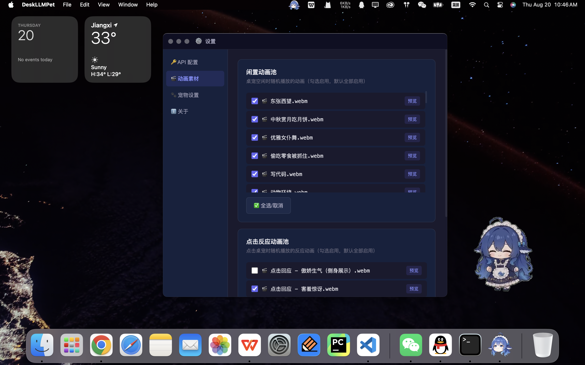
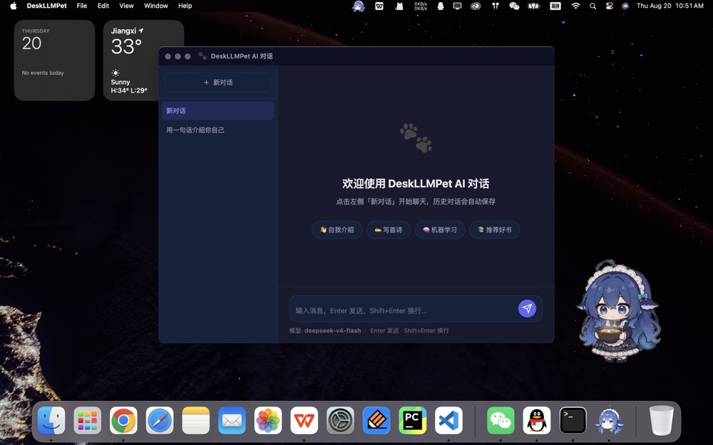

<div align="center">


# 🐾 DeskLLMPet 桌宠大肥鱼 doge~

**会报 API 余额、可插件化扩展（内置 AI 对话）的桌面宠物**

[](LICENSE)
[](https://www.electronjs.org/)
[](#)
[](https://github.com/isKage/desk-llm-pet/releases)
[](https://github.com/isKage/desk-llm-pet/actions/workflows/check.yml)
[](https://github.com/isKage/desk-llm-pet/pulls)

</div>

> 本项目**完全由 DeepSeek Harness 生成**。

> 感谢 [dsh-pet](https://github.com/PC2005-cloud/dsh-pet) 项目的灵感，本项目的所有动画素材均来自 dsh-pet 项目。

> 本项目桌宠形象采用【DeepSeek 娘】，侵权则删。提供自定义桌宠形象功能，见 [自定义图标与动画](docs/guide/customize.md)。


<div align="center">


</div>

---

## ✨ 功能特性

### 🎬 桌面宠物
- **WebM 动画播放**：支持透明通道的 WebM 素材，随机闲置动画 + 点击反应。
- **窗口裁剪**：动画保持原大小，窗口只保留主体，桌面占用更小；支持画面偏移，拖动即时预览。
- **点击互动**：**单击**播反应动画；**双击**弹气泡（余额卡片或自定义语句）。
- **拖拽移动**：按住宠物拖到屏幕任意位置。
- **右键菜单**：独立菜单窗口，按内容自适应大小，插件项再多也能滚动看完。

### 💰 API 余额气泡
- **独立气泡窗口**：透明悬浮，不遮挡宠物、不挡鼠标。
- **大小 / 位置可调**：0.6~1.6 倍，水平/垂直偏移可调，可一键预览。
- **余额卡片**：总余额 + 充值/赠送明细 + 可用状态。
- **定时展示 / 双击即查**：间隔可配；关闭余额后双击随机展示自定义语句。
- **官方接口**：默认调用 `https://api.deepseek.com/user/balance`，地址可自定义。

### 🧩 插件化扩展
- **像模组一样安装**：下载 `.dlmpet` 插件包，在 **设置 → 🧩 插件** 中选择/拖入即可；也可以直接放进插件目录，重启或点「重新扫描」自动安装。
- **完全解耦**：插件加载失败只跳过该插件，本体照常运行。
- **扩展点**：桌宠右键菜单、系统托盘菜单、设置页表单、命名空间化 IPC、插件独立存储与窗口。
- **内置 AI 对话**：多会话管理、流式回复、历史本地保存。

### ⚙️ 可视化配置
- API 配置、动画素材、宠物外观、窗口裁剪、气泡、余额气泡、双击语句、开机自启。
- 插件自带设置面板；插件管理页支持启用/禁用、更新、卸载、打开插件目录。

---

## 📦 安装与运行

### 方式一：下载预构建安装包（推荐）

到 [Releases](https://github.com/isKage/desk-llm-pet/releases/latest) 下载对应平台的安装包：

| 平台 | 文件 |
|---|---|
| 🍎 macOS（Apple Silicon） | `DeskLLMPet-<version>-arm64.dmg` |
| 🍎 macOS（Intel） | `DeskLLMPet-<version>.dmg` |
| 🪟 Windows x64 | `DeskLLMPet Setup <version>.exe` |

安装、覆盖升级、卸载与数据清理见 **[安装、升级与卸载](docs/guide/install.md)**。

### 方式二：从源码构建运行

```bash
git clone https://github.com/isKage/desk-llm-pet.git
cd DeskLLMPet
npm install
npm run dev
```

打包：`npm run build:mac` / `npm run build:win` / `npm run build:all`，产物在 `dist/`。
版本号与发布流程见 [本地开发与发布](docs/dev/development.md)。

---

## 🔑 API 配置

右键桌宠 → **设置 → API 配置**，填入 [DeepSeek 开放平台](https://platform.deepseek.com/api_keys) 的 API Key。

- 双击桌宠展示余额（单击只播动画）；
- 默认每 30 分钟自动展示一次，可调间隔或关闭；
- 关闭余额气泡后，双击会从自定义语句里随机展示一句；
- 密钥仅保存在本地，不会上传。

完整配置说明见 **[API 与桌宠配置](docs/guide/configure.md)**。

> AI 对话是内置插件，有独立配置页（**设置 → 💬 AI 对话**）；留空的 Key / 地址会回退使用本体 API 配置。

---

## 🧩 插件

- **安装与管理**：**[安装与管理插件](docs/plugins/installing.md)**
- **开发指南**：**[插件开发指南](docs/plugins/development.md)**
- **打包成 `.dlmpet`**：**[打包插件](docs/plugins/packaging.md)**

插件代码和用户插件数据都在 Electron 的 `userData` 目录，升级应用不会覆盖；安装插件不需要改项目代码。

---

## 📚 文档

全部文档在 **[docs/](docs/README.md)**：

| 文档 | 内容 |
|---|---|
| [安装、升级与卸载](docs/guide/install.md) | 下载哪个包、覆盖升级、清理数据 |
| [API 与桌宠配置](docs/guide/configure.md) | API、余额气泡、动画池、外观、双击语句 |
| [自定义图标与动画](docs/guide/customize.md) | 换图标、添加 `.webm`、素材格式 |
| [常见问题](docs/guide/faq.md) | 单实例、版本不生效、签名提示、插件问题 |
| [技术架构](docs/dev/architecture.md) | 进程/窗口/插件/IPC 设计 |
| [本地开发与发布](docs/dev/development.md) | 环境、自检、打包、版本与 Release |
| [更新日志](CHANGELOG.md) | 每个版本的新增、修复与升级说明 |

---

## 🛠️ 技术栈

| 技术 | 用途 |
|---|---|
| [Electron 28](https://www.electronjs.org/) | 跨平台桌面框架 |
| [electron-builder](https://www.electron.build/) | 打包与分发 |
| [electron-store](https://github.com/sindresorhus/electron-store) | 本地持久化存储 |
| [adm-zip](https://github.com/cthackers/adm-zip) | 插件包（`.dlmpet`）解压 |
| 原生 HTML/CSS/JS | 渲染进程 UI |
| DeepSeek 余额接口 | API 余额查询 |

---

## 📝 开发

```bash
npm run dev             # 开发模式
npm run dev:tools       # 开发模式 + DevTools
npm run check           # 静态自检（语法/插件/安装器/文档/结构）
npm run check:renderer  # 真实 Electron 冒烟测试（四个页面 + IPC）
npm run clean           # 清理 dist / 冒烟数据 / .DS_Store
```

约定：渲染进程不开 `nodeIntegration`，一律走 preload + IPC；窗口位置/尺寸统一用 `setBounds`；插件管理操作只允许设置窗口调用。

详见 [本地开发与发布](docs/dev/development.md) 与 [贡献指南](CONTRIBUTING.md)。

### 安全原则

- `contextIsolation: true`，通过 `contextBridge` 暴露最小 API；
- 插件 IPC 通道统一命名空间化（`plugin:<插件id>:<通道>`），插件窗口禁止导航到插件目录之外；
- 插件在主进程中运行，**没有沙箱**，只安装可信来源的插件包；
- API 密钥仅存储在本地。

---

## 📄 License

MIT © [isKage](https://github.com/isKage)

---

<div align="center">
  <sub>Made with ❤️ by DeskLLMPet</sub>
</div>
